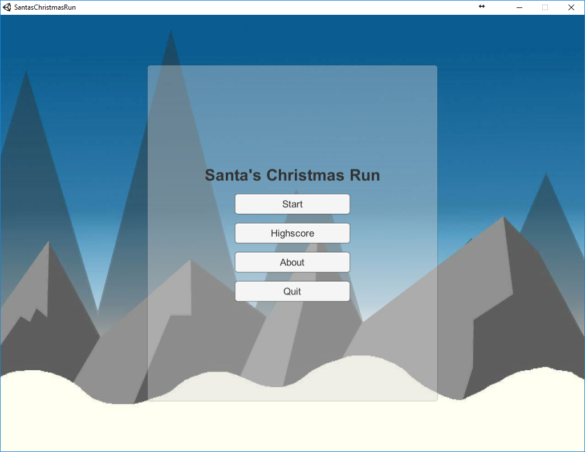

# Santa's Christmas Run

**TEAM CK · Game Design & Development · Winter Semester 2017/18**

Santa's Christmas Run is a 2D endless-runner prototype. After delivering the presents on Christmas Day, Santa discovers that they have been stolen and sets off to find them. The project explores a replayable run through a snowy world built from procedurally arranged platforms.



## Play

The repository includes a prebuilt Windows version in `Game/`. To start it, run `Game/RunnerGame.exe`. The executable is an earlier build; rebuild the Unity project with its documented Unity 2017.2.0f3 editor version to include the new characters.

Click **Start** in the main menu to open character selection in that same scene. Choose Santa or one of four additional Christmas characters—Peppermint Elf, Snowflake Scout, Gingerbread Runner, or Reindeer Dash—using the character buttons or `1`–`5`, then select **Start Run**. Your choice is saved for the next run. The additional characters have separate idle and running animations.

Choose **Language** in the main-menu navigation to open the flag selector. German, English, and French are included; the selected language is saved between runs and used by the menus, pause screen, game-over screen, and HUD. The selector discovers language bundles automatically. The game-over screen includes retry, quit, and return-to-main-menu actions.

## Shared UI theme

The main menu and its About/Highscore submenus, character and language selectors, gameplay HUD, pause panel, and game-over screen share the palette, typography, and spacing rules in `Game/RunnerGame/Assets/Controller/GameUITheme.cs`. Forest green panels use warm-cream text; cream cards use deep-green text; primary actions use Christmas red, secondary actions use green, and panels share a gold outline. Theme helpers apply at least 5 px of internal padding to labels and button content and 5 px of spacing between selector options. Main-menu and About/Highscore panel widths and content areas adapt to the Canvas viewport, with dedicated space for submenu navigation. New Unity UI panels, buttons, and labels should use `GameUITheme.ConfigurePanel`, `ConfigureButton`/`ConfigureMenuButton`, and `ConfigureText`; immediate-mode GUI screens should use its shared panel, label, and button style helpers.

| Action | Controls |
| --- | --- |
| Jump | `Space` or `Up Arrow` |
| Move left | `A` or `Left Arrow` |
| Move right | `D` or `Right Arrow` |
| Pause / resume | `Escape` |
| Restart after a run | `R` |
| Return to the main menu after a run | `M` |

Holding the jump button is designed to produce a higher jump than a brief press. In the prototype design, movement also starts the camera scrolling, and its speed increases as the run progresses.

## Gameplay and design

The central design goal is procedural platform generation: the route is assembled as the player runs, with different platform arrangements and gaps to navigate. The design documents describe increasing difficulty over time and a snowy setting. Collectibles, enemies, and additional settings appear in the broader concept, but some are identified as future or lower-priority features; their availability in the included build is not guaranteed.

The prototype presentation describes a platform-selection approach that considers the previous platform and its height, then chooses a neighboring placement or a gap. Treat this as design documentation rather than a guarantee that every planned mechanic is present in the shipped executable.

## Adding character sprites

Put each animation frame in `Game/RunnerGame/Assets/Resources/ChristmasCharacters/` using the existing character and animation filename pattern. In Unity's Sprite Editor, set each frame's custom pivot at the character's foot-contact line, excluding any translucent shadow beneath the feet. The runtime aligns this pivot to the player collider, so frames can use different image sizes and pixel densities without moving the character off the ground. Keep the pivot at the same physical foot baseline across all frames of a character to prevent animation bounce.

## Adding a language or translation

Translations use JSON because Unity can load JSON text assets directly from `Resources` without an extra parser dependency. To add a selectable language, add a `<code>.json` file to `Game/RunnerGame/Assets/Resources/Localization/`; no C# changes are needed. Each bundle contains its own metadata and translations:

```json
{
  "languageCode": "es",
  "displayName": "Español",
  "flag": "🇪🇸",
  "entries": [
    { "key": "menu.start", "value": "Jugar" }
  ]
}
```

Use a unique language code, a display name, a Unicode flag, and an `entries` array of `{ "key": "...", "value": "..." }` objects. Add translations for the same keys used by the other bundles; missing entries fall back to English when available, otherwise to the first discovered language. Use `Localization.Get("your.key")` for fixed text and `Localization.Format("your.key", value)` for text with numbered placeholders such as `{0}`. The bundle is loaded from Unity's `Resources` at runtime, so it will be included in player builds when the project is built.

## Repository contents

- `Game/` — packaged Windows game build and Unity runtime files; editable Unity project/source files are not included.
- `docs/1_[TEAM_CK]_GDD.pdf` — game design document.
- `docs/1_[TEAM_CK]_GDD_PRESENTATION.pdf` — design presentation.
- `docs/2_[TEAM_CK]_Prototype1.pdf` — first prototype presentation, including early platform-generation notes.
- `docs/3_AND_4_TEAM_CK/` — second prototype presentation, post-mortem, and screenshots.
- `docs/img/` — supporting concept art, diagrams, and prototype screenshots.

## Project history

This is a student game-design project from the 2017/18 winter semester. The included presentations document how the focus shifted toward procedural map generation and a playable prototype. They provide useful context for intended mechanics and development decisions, but may describe plans that differ from the packaged build.
